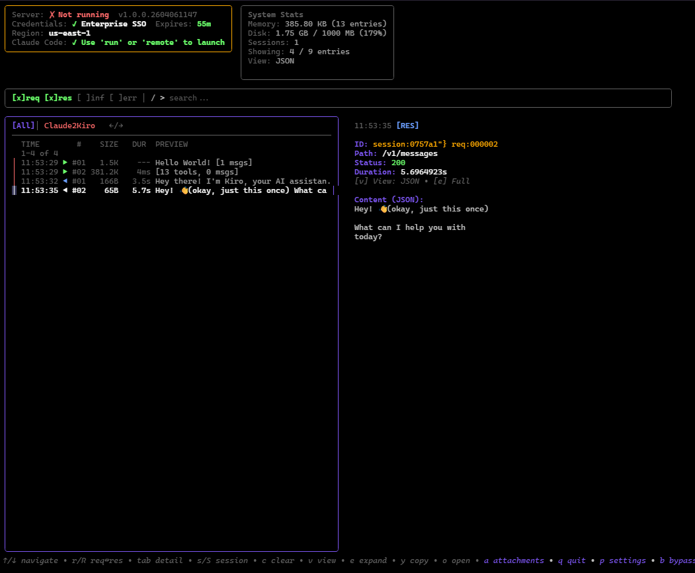
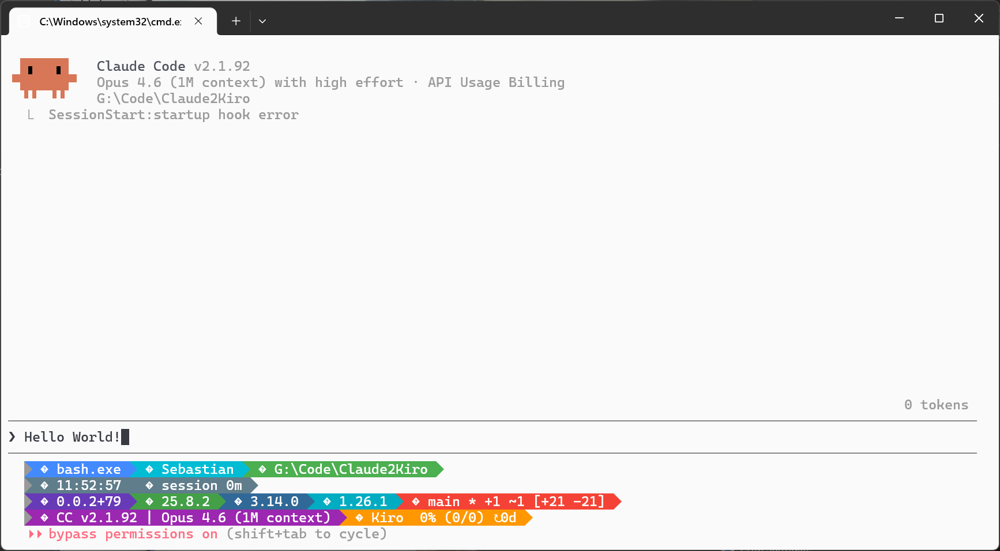

# Usage

## Quick start

```bash
claude2kiro
```

This opens the interactive TUI, which is the easiest way to use Claude2Kiro.

You can also use the direct command flow:

```bash
claude2kiro login
claude2kiro run
```

## Core commands

### `claude2kiro`

Launches the interactive TUI.

From there you can:
- log in to Kiro
- start the proxy
- inspect sessions and logs
- open settings
- launch Claude Code

<p align="center">
  
</p>

### `claude2kiro login`

Opens the browser-based login flow and stores your Kiro credentials locally.

Supported login methods:
- GitHub
- Google
- AWS Builder ID
- Enterprise Identity Center

Examples:

```bash
claude2kiro login github
claude2kiro login google
claude2kiro login builderid
claude2kiro login idc d5
claude2kiro login idc my-company
```

GitHub and Google use Kiro's device authorization: the terminal prints a short code and an
`app.kiro.dev` link, you approve the code in the browser, and the login finishes on its own
(no local callback port is involved).

`--no-browser` prints the sign-in URL instead of opening the default browser, so a second
identity can be signed in from a private window while the default browser holds the first
one's session. Set `CLAUDE2KIRO_PROFILE=<name>` to keep that identity's token, login
config and credit history under their own file names:

```bash
CLAUDE2KIRO_PROFILE=agentes claude2kiro login --no-browser idc d5
```

### `claude2kiro run`

Starts the local proxy and launches Claude Code through it.

This is the main day-to-day command.

It:
- starts the proxy
- prepares the Claude Code environment
- installs or refreshes the local plugin
- launches Claude Code using your Kiro-backed access

Arguments after `run` go to Claude Code unchanged, so `claude2kiro run --resume <session-id>`
resumes a previous Claude Code session. The resume-first spelling
`claude2kiro --resume <session-id> run [claude args...]` is accepted too and means the same.

<p align="center">
  
</p>

When launched this way, Claude Code shows that the session is powered by **Kiro via claude2kiro proxy**.

It also installs the local **kiro-proxy** plugin so you can use these slash commands inside Claude Code:
- `/kiro-proxy:status`
- `/kiro-proxy:credits`
- `/kiro-proxy:logs`
- `/kiro-proxy:models`
- `/kiro-proxy:config`

### Choosing a model

Claude Code's `/model` dialog only lists the models built into your Claude Code
binary — it does not query the proxy. On an older Claude Code build the newest
models are simply missing from that dialog (Homebrew in particular lags behind;
prefer the native installer from <https://claude.ai/install.sh> and keep Claude
Code updated).

Every model Kiro exposes works regardless of what the dialog shows:

- **in-session**: type `/model claude-opus-4-8` (any id from `/kiro-proxy:models`,
  Anthropic-style `claude-opus-4-8` or Kiro-style `claude-opus-4.8`)
- **at launch**: `claude2kiro run --model claude-opus-4-8`
- **via env**: `ANTHROPIC_MODEL=claude-opus-4-8 claude2kiro run`
- **as default**: set `"model": "claude-opus-4-8"` in `~/.claude/settings.json`

Run `claude2kiro models` (CLI) or `/kiro-proxy:models` (inside Claude Code) to
see the live list with credit multipliers.

Being logged into claude.ai when you **launch** `claude2kiro run` is fine: with
the proxy environment set, requests go through the proxy and are served by
Kiro. Login state at launch only changes which entries the `/model` dialog
shows.

What you must **not** do is run `/login` (or log out and back in) *inside* a
claude2kiro session. Choosing "Claude account with subscription" there switches
the session out of API mode — from that point requests go directly to Anthropic
on your subscription, bypassing Kiro entirely. If that happens, exit Claude
Code and relaunch with `claude2kiro run` to get back on Kiro billing.

#### No Claude account needed — but Kiro model lists are per-account

claude2kiro does **not** require a Claude/Anthropic account or subscription:
Claude Code runs in API mode against the local proxy. Without a claude.ai
login the `/model` dialog just shows fewer entries — switching by id
(`/model <id>`) works the same.

Kiro, however, exposes models **per account and plan**: `claude2kiro models`
(or `/kiro-proxy:models`) shows the list for *your* account, and a model
missing from that list is rejected by Kiro even though the proxy forwards it.
When the proxy has to resolve a generic model id (like a bare `opus` alias),
it picks the highest version *your* account offers — which is why an account
without preview models lands on Opus 4.6.

The proxy keeps that list for 10 minutes. When fetching it fails
(`ListAvailableModels` unreachable), the proxy keeps using the last list it
got, or the build-time model table when it never got one, and does not try
again for 30 seconds, so requests do not each wait for a failing fetch. Moving
to another identity fetches the list again at once.

Quick checks:

- **Which model is the session on?** The statusline shows the id Claude Code
  sends; `curl -s "$ANTHROPIC_BASE_URL/resolve?model=<id>"` (inside a session)
  or `claude2kiro resolve <id>` shows the Kiro model that serves it and
  whether your account has it (`in_live_catalog`).
- **Does it actually respond?** `claude2kiro test "Reply with OK" <kiro-id>`
  sends a real request (uses a fraction of a credit).

If Claude Code's input freezes after `/model <id>` (Esc once or twice
recovers), update Claude Code — Homebrew lags several versions behind; use
the native installer from <https://claude.ai/install.sh>.

### `claude2kiro update`

Downloads the latest release and switches the launcher to the new version.

Use this when you want to upgrade without reinstalling manually.

## Full command list

| Command | Description |
|---|---|
| `claude2kiro` | Launch the interactive TUI |
| `claude2kiro login` | Open the browser-based login flow |
| `claude2kiro read` | Show saved token information |
| `claude2kiro refresh` | Refresh the current token |
| `claude2kiro export [--show-token]` | Print environment variables for manual proxy usage (see below) |
| `claude2kiro claude` | Configure Claude Code globally |
| `claude2kiro run [args...]` | Start proxy and launch Claude Code (installs Claude Code if missing) |
| `claude2kiro remote [args...]` | Launch Claude Code against an already-running proxy |
| `claude2kiro desktop` | Windows: install/configure/launch Claude Desktop routed through the proxy |
| `claude2kiro server [port]` | Run the proxy without launching Claude Code |
| `claude2kiro credits [--web\|--all]` | Show credit usage (`--web` opens the live dashboard, `--all` lists every identity in failover order) |
| `claude2kiro update` | Download the latest release |
| `claude2kiro logout` | Remove saved credentials |

### `claude2kiro export`

Prints the variables that point a shell at a running proxy. The API key it prints is the
proxy key `claude2kiro`: the proxy signs each request with your Kiro token itself and does
not read the client's key, so your access token never needs to be on screen or in shell
history. On Linux and macOS the output can go straight to `eval`:

```bash
eval "$(claude2kiro export)"
```

`claude2kiro export --show-token` prints the Kiro access token as the API key instead, for
tools that want the real token. Treat that output as a secret.

## Update flow

If installed via the quick installers, Claude2Kiro uses a launcher plus a versioned binary.

- launcher: `~/.local/bin/claude2kiro` or `%USERPROFILE%\.local\bin\claude2kiro.exe`
- app: `~/.claude2kiro/bin/claude2kiro-X.Y.Z` or `%USERPROFILE%\.claude2kiro\bin\claude2kiro-X.Y.Z.exe`

`claude2kiro update` downloads a new versioned binary and switches `current.txt` to it.

## Configuration

Settings are saved in `~/.claude2kiro/config.yaml`; a process started with
`CLAUDE2KIRO_PROFILE=<name>` reads `~/.claude2kiro/config.<name>.yaml` instead when that
file exists (and always saves there). You can edit them directly, or press `p` (Settings)
in the TUI dashboard.

Failover between Kiro identities lives here too. Once a second identity is logged in,
list it in the config file the proxy actually reads and the proxy switches to it on its
own when the active pool answers `402 MONTHLY_REQUEST_COUNT` (sticky until the proxy is
restarted; `""` names the unnamed profile):

```yaml
auth:
  fallback_profiles: [agentes]
```

Some useful settings:
- **Auto-Start Server**: automatically start the proxy server when the app is launched.
- **Debug Mode**: save raw request and response data to `~/.claude2kiro/debug/` for troubleshooting.

### Experimental credit controls

These reduce the tokens Kiro ingests per request. Defaults are conservative
(full history, full tools) — change them only after reading
`docs/benchmarks/2026-06-30-credit-reduction.md`, since aggressive modes can
change model behavior:

| Setting | Values | Effect |
|---|---|---|
| `advanced.history_mode` | `full` (default), `recent`, `current_only` | How much conversation history is resent. `recent` keeps the last `history_recent_turns` turns; `current_only` relies on the stable `conversationId` session. Required tool-use/tool-result pairs are always preserved. |
| `advanced.history_recent_turns` | int (default 4) | Turns kept when `history_mode=recent`. |
| `advanced.tool_mode` | `full` (default), `compact`, `none_text` | `compact` trims long tool descriptions to `tool_compact_max_chars`; `none_text` removes tool definitions and converts past tool calls to text. |
| `advanced.tool_compact_max_chars` | int (default 1024) | Description cap for `tool_mode=compact`. |
| `advanced.aggressive_cache_points` | bool (default false) | Insert a `cachePoint` after tool definitions even when Claude Code sent no `cache_control`. |

Benchmarked locally (see the benchmark doc): `none_text` cut credits ~68% on
no-tool suites; `aggressive_cache_points` cut ~34-36% on both suites.

### Thinking

| Setting | Values | Effect |
|---|---|---|
| `advanced.thinking_mode` | `client` (default), `backend` | `client` sends the thinking the client asked for: off when it sent no `thinking` field (as Claude Code started by `claude2kiro run` does), adaptive when it asked for thinking, and only when the model's catalog schema allows that value. `backend` sends no `thinking` field, so Kiro applies its default, adaptive thinking on. Unknown values count as `client`. |
| `advanced.reasoning_history_max_bytes` | int (default 4194304) | The proxy keeps the model's signed reasoning in memory and gives it back to Kiro in the history of later turns of the same model, newest turns first, up to this many bytes per request. `0` turns it off. Lost on restart. |
| `advanced.reasoning_history_max_blocks` | int (default 0) | Caps how many earlier turns carry their reasoning, newest first, on top of the byte cap. `0` means no limit. Meant for measurements (for example `1`, newest only); the default is unchanged. |

Thinking changes speed and cost a lot. On one agent step of 91k input tokens,
Opus 5.5 with adaptive thinking took 329 s and 8.26 credits; Opus 4.8 with
thinking off took 13.2 s and 0.86 credits, Sonnet 5 with thinking off 5.2 s and
0.43 credits. Opus 5.5 and Sonnet 5.5 cannot turn thinking off, so they keep it
in both modes.

The reasoning given back changes cost too. On a second turn of that step with
`auto`, the request without the earlier reasoning took 290 s and 4.22 credits
and the model planned again; with it, 44.5 s and 1.36 credits. Details in
[PROTOCOL_TRANSLATION.md](PROTOCOL_TRANSLATION.md).

### Interrupted responses (Kiro's 240-second limit)

Kiro ends a response it has sent nothing on for about 240 seconds, and it sends
a tool call's input only once the model has finished writing it, so a large file
written in one `Write` call can take longer than that and never arrive. A tool
call can also stop at the model's output limit (`MAX_TOKENS`). The proxy handles
both the way Kiro's own client does:

- It holds every tool call until the response has ended (text streams as it
  arrives), so Claude Code never receives an incomplete tool call.
- Interrupted before any tool call started: it sends the same request again
  after about half a second (a cut request is not charged). If text already
  reached Claude Code, it asks Kiro to continue from that text instead. Logged as
  `[WRN] Interrupted response ... path 1` (same request) or `path 2`.
- Interrupted inside a tool call, or stopped at the output limit inside one: it
  answers that call with a failed tool result saying the call was not executed
  and how to split the work (`Write` for the first part, at most about 50 lines,
  then several small `Edit` calls), asks Kiro again in the same conversation and
  streams the new answer to Claude Code as the rest of the same message. Logged
  as `[WRN] Interrupted response ... path 2`.
- At most 3 recoveries per response. After that, or with the switch off, the
  response fails with an error that says what happened. Logged as
  `[ERR] Interrupted response ... path 3`.

The failed call and its tool result go to Kiro only: Claude Code never receives
them and they are not in its transcript. So that Kiro sees a consistent
conversation, the proxy keeps that exchange in memory (per conversation, at most
256 responses and 16 MiB, six hours, lost on restart) and puts it back into the history of
every later request, before the message Claude Code recorded for that response.

| Setting | Values | Effect |
|---|---|---|
| `advanced.interrupted_tool_recovery` | bool (default true) | The recovery above. `false`: an interrupted response fails as an error. An idle cut or a call cut by the output limit gets an error Claude Code does not resend, since sending it again would end the same way; another broken stream stays retryable. |
| `network.backend_idle_cut_after` | duration (default `230s`) | Backend silence after which a broken response is reported as Kiro's idle cut in the log and the error. |

The live web dashboard (`claude2kiro credits --web`) charts credit history,
burn rate, and projected runout from samples recorded every 15 minutes while
the proxy runs.

## Troubleshooting

### Token file not found

Run:

```bash
claude2kiro login
```

### 403 Unauthorized

Your token may be expired. Try:

```bash
claude2kiro refresh
```

### Claude Code not found

`claude2kiro run` offers to install Claude Code automatically (winget on
Windows, Anthropic's install script elsewhere, npm as fallback). If the
install just finished and `claude` still isn't visible, open a new terminal
and re-run:

```bash
claude2kiro run
```
